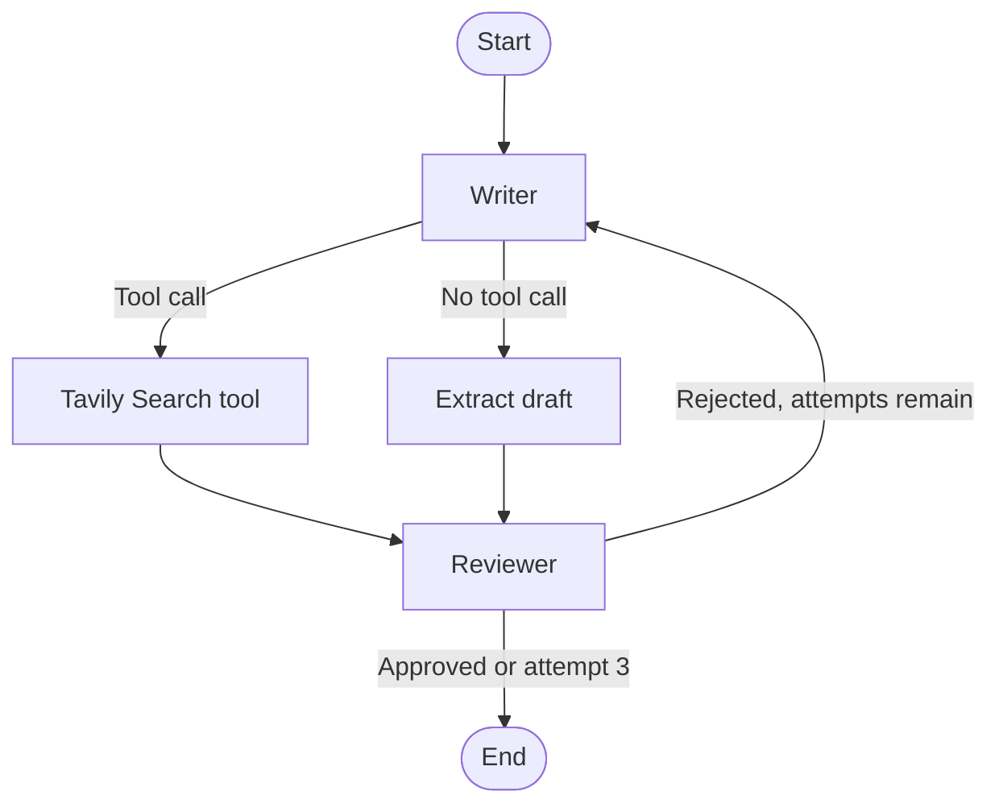

# LinkedIn Post Generator

A Python application that drafts LinkedIn posts and asks a Gemini-powered reviewer to assess each draft. The project includes a Streamlit interface and a command-line version.


## Features

- Drafts a professional post from a topic, aiming for 150–200 words, a strong opening hook, short paragraphs, one takeaway, and a closing question or call to action.
- Uses a LangGraph writer–reviewer loop. The writer can call Tavily Search for current context, with up to three results requested per search.
- Reviews drafts against the rubric below and asks the writer to revise rejected drafts.
- Stops when the reviewer approves a draft or after **three total attempts** (the first draft plus at most two rewrites).
- Offers a Streamlit preview, attempt history, word and character counts, and a text-file download. The CLI prints a framed post and reports the attempt count and approval result.

## Reviewer rubric

The reviewer is prompted to check that a post has:

1. A strong hook in the first line
2. One clear, valuable takeaway
3. Short, skimmable paragraphs
4. Roughly 150–200 words
5. An engaging closing question or call to action
6. A professional, human tone
7. No hashtags

Approval is an LLM judgment based on this prompt; it is not a guarantee that a post is accurate or ready to publish without human review.

## How the graph runs



The writer and reviewer both use `gemini-3.5-flash-lite`. The writer is configured with temperature `0.7`; the reviewer uses temperature `0`. Tavily search is optional: the writer is instructed to use it when a topic needs current information.

## Requirements and dependency note

The project targets Python 3.10 or newer. `requirements.txt` lists LangGraph, LangChain packages, the Gemini integration, `python-dotenv`, Streamlit, and additional packages for embeddings, vector search, and PDF handling.

Both Python entry points import `langchain_tavily.TavilySearch`, but `langchain-tavily` is not currently listed in `requirements.txt`. The install command below includes it explicitly. Several other packages in `requirements.txt` are not imported by the provided `main.py` or `UI.py` files.

## Setup

1. Create and activate a virtual environment from the project directory:

   ```bash
   python -m venv .venv
   ```

   Windows PowerShell:

   ```powershell
   .\.venv\Scripts\Activate.ps1
   ```

   macOS or Linux:

   ```bash
   source .venv/bin/activate
   ```

2. Install the declared requirements and the missing Tavily integration:

   ```bash
   python -m pip install --upgrade pip
   python -m pip install -r requirements.txt langchain-tavily
   ```

3. Create a local environment file from the example:

   ```powershell
   Copy-Item .env.example .env
   ```

   On macOS or Linux, use `cp .env.example .env` instead.

4. Edit `.env` and replace the placeholders with newly issued credentials. The application calls `load_dotenv()` to load these values.

## Environment variables

| Variable | Used for |
| --- | --- |
| `GOOGLE_API_KEY` | Authenticates `ChatGoogleGenerativeAI` calls to Gemini for writing and review. |
| `TAVILY_API_KEY` | Authenticates Tavily Search when the writer requests web search. |

Keep real values in `.env` or another private secret store. The supplied `.gitignore` excludes `.env` and other `.env.*` files while allowing the placeholder-only `.env.example` to be committed.

## Run the application

From the project directory, start the Streamlit interface:

```bash
streamlit run UI.py
```

Or run the command-line version:

```bash
python main.py
```

The CLI prompts for a topic. The Streamlit app lets you enter a topic or choose a prompt starter, then shows the generation trace and final post preview. Neither entry point publishes to LinkedIn; review and post the result yourself.

## Limitations and implementation notes

- **Search branch draft handling:** In the current graph, a writer tool call goes from the Tavily tool node directly to the reviewer. It bypasses the `extract_draft` node, so a search-assisted run may send an empty or stale draft to review. The search path should be corrected before relying on web-assisted output.
- **Approval parsing:** The reviewer verdict is parsed from generated text using a substring check for `APPROVED` before `FEEDBACK`. Unexpected reviewer wording could be interpreted incorrectly.
- **Human review is still needed:** The rubric is prompt-based, not a fact checker or automated policy/compliance check. Search results can be incomplete or out of date, and generated claims should be verified before publishing.
- **Session history is temporary:** The Streamlit history is held in session state and is not saved to a database or file.
- **API access is required:** Gemini and (when used) Tavily require working credentials, network access, and any applicable provider quotas or billing.
